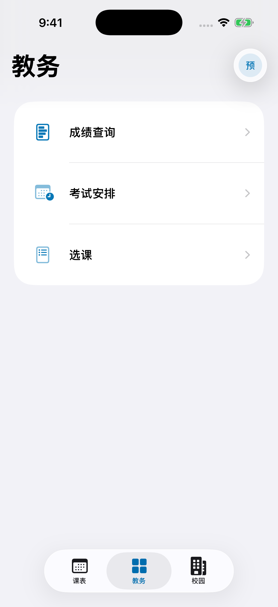
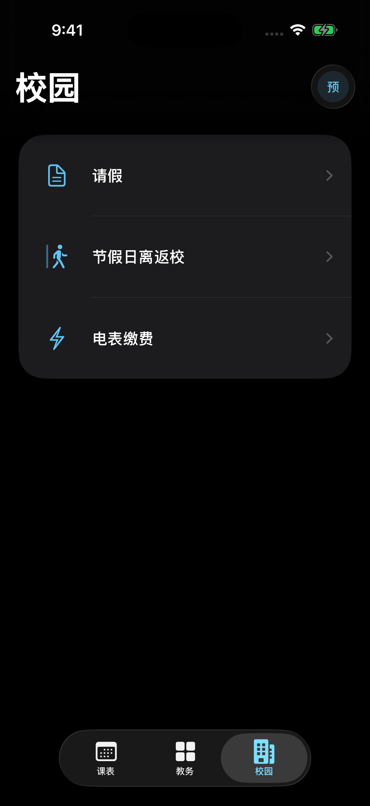

  

<h1 align="center">长工院</h1>

把课表、教务和校园事务放进一个原生 iOS 应用。

  
  

为长沙工业学院同学制作的非官方 iOS 应用，用学校账号即可使用。查课表、看成绩、办校园事务，少翻几个页面。

## 日常能做什么

| 页面 | 功能 |
| --- | --- |
| 课表 | 按周查看课程、时间和地点 |
| 教务 | 看成绩、绩点和考试安排，查看已选课程，办理选课、退课 |
| 智慧校园 | 请假、节假日离返校登记与记录查询，查看宿舍电表信息、缴纳电费 |

  
  

截图中的内容为演示数据。

## 安装

需要 **iOS 26 或更新版本**。

前往 [下载页面（Releases）](https://github.com/54zhien/ccsut/releases/latest)，下载最新版 IPA，并按该版本的说明安装。

> [!NOTE]
> IPA 不能像 App Store 应用一样直接点开安装，需要使用签名工具。具体以下载页面的说明为准。

## 使用说明

- 本项目不是学校官方应用，数据和办理结果以学校系统为准。
- 请假、选退课和缴费前请仔细核对。若提交后没有收到明确结果，先查记录，避免重复操作。
- 学校系统调整或维护时，部分功能可能暂时不可用。

## 反馈与开发

遇到问题或有建议，欢迎[提交反馈](https://github.com/54zhien/ccsut/issues)。附上使用的版本和操作步骤会更方便排查，截图前记得遮住学号、手机号等个人信息。

想自己编译或了解代码，可以阅读 [iOS 开发指南](ios/README.md)。
